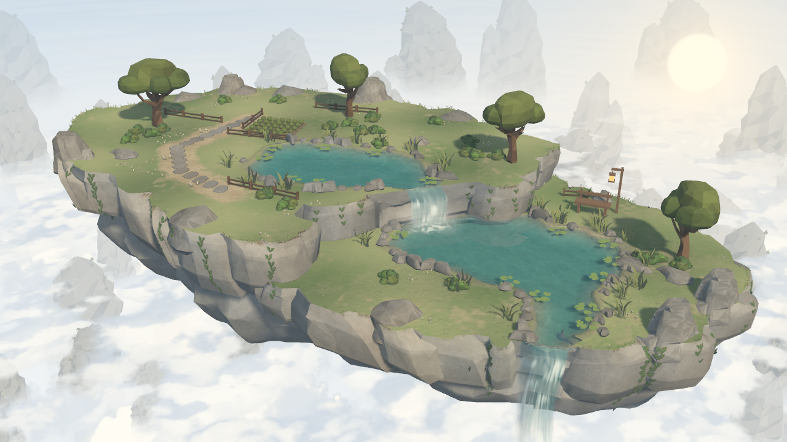

# 历史基准与当前实机

- `original/game.png`、`original/whole.png`：2026-10-20本阶段刚接手时的历史Godot输出，保留旧房屋，仅作比较。
- `current/`：清理后重新采集的真实Godot输出，旧房屋已移除。不是概念图或离线渲染。

场景 `res://scenes/terrain_editor.tscn`，人工预设0、seed7301；Godot4.7.2／Forward+／Metal，1280×720、4xMSAA、FOV31。正常机位center(0,-1)、height21、pitch27、yaw16；整体机位center(-2,-1)、height32、pitch30、yaw16；反向yaw196；近景center(-10,-5)、height13、pitch30。光照恢复基准：太阳(-42,40,0)、能量1.18、fill0.19、ambient0.45、默认曝光。采集相位1.25，正常运行仍动态。

重拍：`Godot --path . --script tools/art/capture_baseline.gd -- --out=res://art/baseline/new_capture`。工具拒绝覆盖已有captures.json，不读写用户布局。工具验证房屋不存在、采集前后数据不变；这些检查不等于美术验收。

本次新鲜验证：4张原生图，房屋不存在、权威地形数据前后exact；现有原生相机／指针编辑／撤销相关运行检查22/22，Tripo本地检查6/6。复原带房屋的临时对照与历史game／whole图分别仅差2／1像素；去房屋后的变化集中在房屋和阴影区域。临时对照与旧工作副本按用户要求删除，只保留数值摘要于verification.json。没有目标设备性能或美术验收结论。
